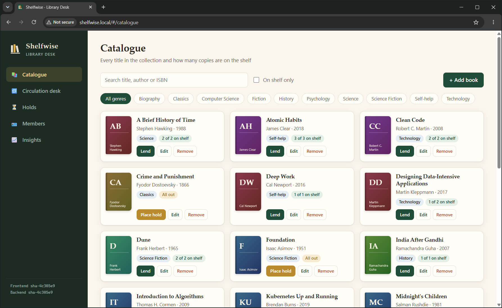
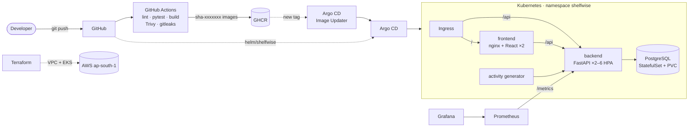

# Shelfwise

**A library circulation platform, built and shipped like a production service.** Librarians use Shelfwise to run the lending desk: catalogue books, issue library cards, lend, return and renew, charge late fines, and keep a fair first-come-first-served queue for books that are out.

The application is the reason for the platform around it. Every commit is linted, tested, scanned and packaged by GitHub Actions, then delivered through GitOps to Kubernetes with Argo CD. The cluster is provisioned on AWS with Terraform and monitored with Prometheus and Grafana.

[](https://github.com/Aanviiii/DevOps-project/actions/workflows/pipeline.yml)

| | |
|---|---|
| **Rubric evidence** | [docs/SUBMISSION.md](docs/SUBMISSION.md): every grading criterion mapped to its file and screenshot |
| **Architecture** | [docs/ARCHITECTURE.md](docs/ARCHITECTURE.md): diagrams and the design trade-offs |
| **Live demo script** | [docs/DEMO.md](docs/DEMO.md) |
| **Troubleshooting lab** | [troubleshooting/RUNBOOK.md](troubleshooting/RUNBOOK.md) |



---

## What the application does

| Area | What a librarian can do | The rule behind it |
|---|---|---|
| **Catalogue** | Add, edit, search and filter books by genre; see copies on the shelf | Availability = copies − loans − copies set aside for holds |
| **Members** | Issue cards (`SW-000042`), set a tier, suspend, view an account | Tiers set loan length, books at once, renewals and fine rates |
| **Circulation desk** | Lend, return, renew; list loans on time, overdue or returned | Checkout is refused with a clear reason (`LOAN_LIMIT`, `FINES_BLOCK`, ...) |
| **Fines** | See what a member owes and record payment | Per-day rate after a grace period, capped per loan, fixed at return |
| **Holds** | Queue for a book that is out; collect it when ready | Strict FIFO; a returned copy waits 3 days for the next member, then passes on |
| **Insights** | KPIs, checkouts per day, popular genres, overdue follow-ups | Read live from the database |

| Tier | Loan | Books at once | Renewals | Fine | Grace | Cap |
|---|---|---|---|---|---|---|
| Student | 14 days | 5 | 2 | ₹2/day | 1 day | ₹100 |
| Faculty | 28 days | 10 | 3 | ₹1/day | 3 days | ₹100 |
| Public | 14 days | 3 | 1 | ₹5/day | none | ₹200 |

Members owing ₹150 or more cannot borrow or renew, and a book other members are waiting for cannot be renewed.

All of these rules live in one pure module, [`backend/app/circulation/`](backend/app/circulation/). Every function takes `today` as an argument, so the tests can pin any date without mocking the clock.

## Architecture at a glance



The full picture, including the AWS network and the reasoning behind each choice, is in [docs/ARCHITECTURE.md](docs/ARCHITECTURE.md).

## Technology

| Layer | Choice |
|---|---|
| Frontend | React 19 + Vite, plain CSS (light and dark themes, responsive), served by unprivileged nginx |
| Backend | FastAPI, SQLAlchemy 2, Alembic migrations, Pydantic validation |
| Database | PostgreSQL 17 |
| Tests | pytest: 111 tests at 98% coverage (pure rules, API, migrations, seed); ruff with bandit rules |
| Containers | Multi-stage Dockerfiles, non-root users, read-only root filesystems, no pip/Node in runtime images |
| CI/CD | GitHub Actions: lint, test, build, Helm and Terraform validation, gitleaks, Trivy, GHCR push |
| Delivery | Argo CD + Image Updater (GitOps, no bot commits) |
| Kubernetes | Helm chart: Deployments, StatefulSet, Services, Ingress, HPA, PDB, NetworkPolicy, `helm test` |
| Infrastructure | Terraform (plain AWS resources): VPC, subnets, IAM, EKS 1.35, Spot node group, add-ons, budget alert |
| Observability | Prometheus metrics (HTTP plus library-specific), alert rules, Grafana dashboard |

## Repository layout

```text
backend/          FastAPI app, circulation engine, Alembic migrations, tests, Dockerfile
frontend/         React app, nginx config template, Dockerfile
activity/         Simulated patrons that keep the API busy
docker-compose.yml
.github/          CI/CD pipeline, Dependabot, PR template
terraform/        AWS VPC + EKS (see terraform/README.md)
helm/shelfwise/   The Kubernetes package, with values for local and EKS
k8s/              Namespace, Argo CD Application and Image Updater
monitoring/       kube-prometheus-stack values
scripts/          up-local / down-local / eks-up / eks-down, k6 load test
troubleshooting/  Three broken deployments, their fixes and a runbook
docs/             Architecture, demo script, rubric evidence and screenshots
```

---

## Run it

### 1. Docker Compose (one command)

```bash
docker compose up --build
```

| URL | What |
|---|---|
| http://localhost:3000 | The library desk |
| http://localhost:8000/docs | Interactive API documentation (Swagger) |
| http://localhost:8000/health, `/ready`, `/metrics` | Liveness, readiness, Prometheus metrics |

On first start the backend migrates the database and seeds a month of realistic activity: 24 books, 12 members, loans, late returns, fines and holds, all replayed through the real lending rules. `docker compose down -v` removes everything, data included.

### 2. Backend on its own

```bash
cd backend
python -m venv .venv && .venv/Scripts/activate      # source .venv/bin/activate on Linux/macOS
pip install -r requirements-dev.txt
pytest -v                                           # 111 tests, no database needed
export SHELFWISE_DATABASE_URL=postgresql+psycopg://shelfwise:<password>@localhost:5432/shelfwise
alembic upgrade head && uvicorn app.main:app --reload
```

### 3. Kubernetes with GitOps (minikube)

```powershell
./scripts/up-local.ps1
```

This one command does the following:
- starts minikube with the ingress and metrics-server add-ons,
- installs Prometheus/Grafana, Argo CD and Image Updater at pinned versions,
- hands the app to Argo CD and waits until it is Synced and Healthy,
- prints every URL and login.

From then on **every commit that passes CI is deployed automatically**. Add `127.0.0.1 shelfwise.local argocd.shelfwise.local grafana.shelfwise.local prometheus.shelfwise.local` to your hosts file and keep `minikube tunnel` running.

### 4. AWS EKS

```powershell
./scripts/eks-up.ps1      # terraform apply (asks first), ingress, secret, helm install, helm test
./scripts/eks-down.ps1    # removes the LB and volume, terraform destroy, checks nothing is left
```

It costs about $0.16/hour. See [terraform/README.md](terraform/README.md) for the cost breakdown and design.

---

## How a change reaches production

1. **Push to `main`** (or open a PR, which runs the same gates without publishing).
2. **Quality gates** run in parallel:
   - ruff lint and format, plus pytest with a 90% coverage floor. A failing test stops everything after it.
   - production frontend build
   - `helm lint` and kubeconform against the Kubernetes 1.35 schemas
   - `terraform fmt` and `validate`
   - gitleaks over the whole Git history
3. **Images** (backend, frontend, activity) are built and scanned by **Trivy**. Any HIGH or CRITICAL CVE fails the run, and findings go to the GitHub Security tab.
4. **Publish**: only images that passed the scan are pushed to GHCR, tagged `sha-<commit>` and never `latest`, with SBOM and provenance attestations.
5. **Deploy**: Argo CD Image Updater sees the new tag within a minute and sets it on the Argo CD Application. Argo CD rolls the Deployments with zero-downtime rolling updates.
6. **Verify**: the sidebar of the app and the `X-Shelfwise-Version` header name the running commit.

PR [#1](https://github.com/Aanviiii/DevOps-project/pull/1) shows the gate working: its first commit added tests for a new rule, CI failed and skipped the image jobs, and the second commit implemented the rule and turned it green.

## Security measures

- **Containers:** non-root UIDs, read-only root filesystems, all Linux capabilities dropped, `RuntimeDefault` seccomp, no privilege escalation. The namespace enforces the *restricted* Pod Security profile.
- **Supply chain:** Trivy on every image (OS and libraries, plus a secret scan) and gitleaks on every commit. Dependabot sends weekly grouped updates. Images carry an SBOM and provenance.
- **Secrets:** nothing in Git. Compose reads `.env`, Kubernetes reads Secrets, and EKS gets a random database password generated at deploy time. `.gitignore` covers `.env`, `*.tfvars` and Terraform state.
- **Network:** NetworkPolicies allow Postgres to be reached only by the backend. nginx sends CSP, `nosniff` and frame-deny headers.
- **AWS:** least-privilege IAM roles, and Pod Identity for the EBS driver (no node-wide permissions, no OIDC provider). The API endpoint can be locked to one IP, and EBS volumes are encrypted.

## Observability

- `/metrics` exposes per-route request counts and latency histograms, plus library gauges and counters read live from the database: books on loan, overdue loans, unpaid fines, hold queue depth, checkouts, returns and refusals by reason.
- Prometheus scrapes it through a ServiceMonitor. Five alert rules cover backend down, error rate, p95 latency, HPA at its ceiling and the overdue backlog.
- A Grafana dashboard (provisioned from the chart) shows all of it, alongside HPA replicas and per-pod CPU.
- `scripts/load-test.yaml` (k6) pushes the backend past its CPU target, so the HPA can be watched scaling from 2 to more replicas.

## Testing

```text
backend/tests/
  test_circulation.py   pure lending rules with pinned dates (fines, limits, renewals, FIFO queue)
  test_books.py         catalogue CRUD, search, validation, conflicts
  test_members.py       cards, tiers, accounts, deletion rules
  test_loans.py         checkout, return, renew, overdue, fine blocks
  test_holds.py         queue order, READY/EXPIRED transitions, renewals vs. waiting members
  test_fines.py         charging at return, settlement, stats and metrics
  test_system.py        health, readiness during a DB outage, metrics, OpenAPI
  test_migrations.py    Alembic builds exactly the schema the models describe
  test_seed.py          demo data fills once and obeys the rules
```

Tests run against an isolated in-memory SQLite database, configured in `conftest.py` before the app is imported, never against Postgres. A frozen clock fixture makes loans overdue by moving time forward.

## Author

Aanvi Solanki, DevOps capstone (Session 21).
