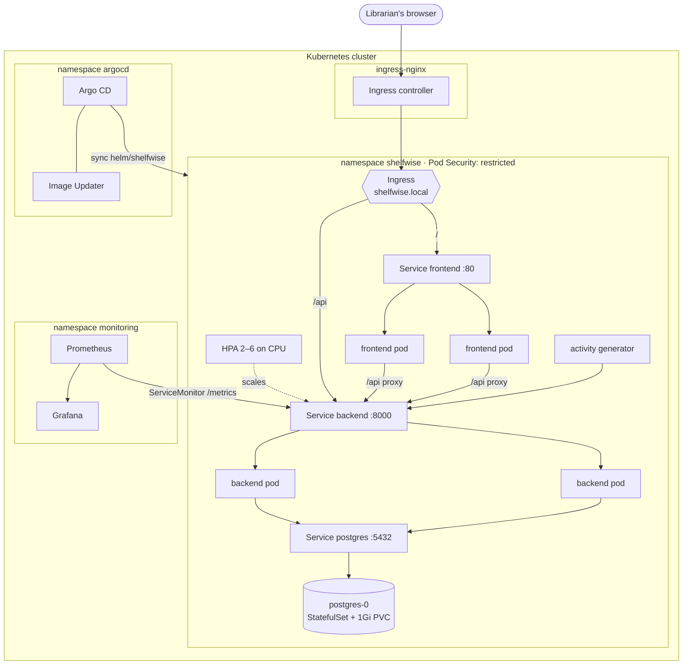
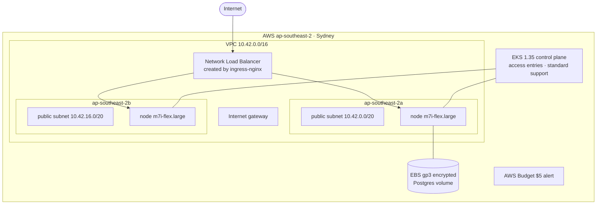

# Architecture

## 1. Runtime: what runs where



| Component | Kind | Replicas | Notes |
|---|---|---|---|
| frontend | Deployment | 2–4 (HPA) | nginx-unprivileged serving the React build; proxies `/api`; `/healthz` probe |
| backend | Deployment | 2–6 (HPA) | FastAPI + uvicorn; migrates on start under an advisory lock; `/health`, `/ready`, `/metrics` |
| postgres | StatefulSet | 1 | PVC-backed; reachable only from backend pods (NetworkPolicy) |
| activity | Deployment | 1 | Simulated patrons; keeps metrics and dashboards alive |
| Ingress | Ingress | n/a | `/api` → backend, `/` → frontend |

### Health checks: why three probes

| Probe | Endpoint | Question it answers | What Kubernetes does on failure |
|---|---|---|---|
| startup | `/health` | Has the app finished starting (migrations, first seed)? | Holds off the other probes for up to 2 minutes |
| liveness | `/health` | Is the process alive and serving? | Restarts the container |
| readiness | `/ready` | Can this pod do useful work, i.e. reach the database? | Takes the pod out of the Service; no restart |

`/health` deliberately ignores the database. If Postgres has a hiccup, restarting every healthy backend would make the outage worse. Readiness simply stops traffic until the database is back. The troubleshooting lab, [scenario 3](../troubleshooting/RUNBOOK.md#3-running-but-never-ready-the-database-rejects-the-app), shows exactly this state.

## 2. Delivery: from commit to running pod

```mermaid
sequenceDiagram
    autonumber
    participant Dev as Developer
    participant GH as GitHub
    participant CI as GitHub Actions
    participant Reg as GHCR
    participant IU as Image Updater
    participant Argo as Argo CD
    participant K8s as Cluster
    Dev->>GH: git push main
    GH->>CI: run pipeline
    CI->>CI: ruff + pytest (≥90% cov), frontend build,<br/>helm lint + kubeconform, terraform validate, gitleaks
    CI->>CI: build 3 images → Trivy gate (HIGH/CRITICAL fails)
    CI->>Reg: push :sha-1a2b3c4 (+SBOM, provenance)
    IU->>Reg: poll every minute for ^sha-[0-9a-f]{7}$
    IU->>Argo: set helm parameter image.tag=sha-1a2b3c4
    Argo->>GH: render helm/shelfwise @ main
    Argo->>K8s: apply; rolling update (maxUnavailable 0)
    K8s-->>Dev: sidebar + X-Shelfwise-Version show sha-1a2b3c4
```

**Why Image Updater with the `argocd` write-back, and not CI committing the new tag to Git?** A CI job that commits `values.yaml` after every build doubles the commit count with bot commits and puts a robot in the history. Here the desired chart lives in Git, the desired *version* lives on the Argo CD Application, and every commit in the repository was written by a person. The trade-off: the running tag is not in Git. It is recorded on the Application and in the image name of every pod, and since tags are commit SHAs, nothing is lost for traceability.

**Rollback** is either `git revert` (a new build moves forward) or pinning the Application's `image.tag` parameter to an older `sha-` tag.

## 3. Infrastructure on AWS



| Decision | Why | Production alternative |
|---|---|---|
| Public subnets only, **no NAT gateway** | A NAT gateway adds ≈ $0.06/hour ($1.40/day) in Sydney before any traffic, about 15% on top of the whole cluster. Nodes keep public IPs, but the EKS-managed security group only admits cluster traffic. | Private subnets for nodes plus a NAT gateway (or VPC endpoints) |
| On-Demand **`m7i-flex.large`** nodes in **Sydney** | The AWS Free plan allows one region (Sydney for this account), no Spot and only Free Tier instance types; all three are Terraform variables | Spot (about 70% cheaper) on a paid account, or mixed capacity with an On-Demand baseline |
| **Pod Identity** for the EBS CSI driver | Scoped to one service account, with no IAM OIDC provider needed (some accounts' policies forbid creating one) | Same |
| `upgrade_policy = STANDARD` | Prevents silently paying 6× for extended support if the cluster outlives its version | Same, with a planned upgrade cadence |
| Local Terraform state | One person, one short-lived cluster; state is git-ignored | S3 backend with DynamoDB/S3 locking |
| Plain resources, no community modules | Every resource is visible and explainable in review | Modules once the patterns are understood |

## 4. Data and consistency

- **Schema changes only through Alembic.** `0001` creates the four tables; `0002` adds fine columns and an index to a live table, safely, with a server default. A test proves the migration history matches the models exactly.
- **Concurrent replicas.** Every backend replica runs `alembic upgrade head` on start; a Postgres advisory lock makes them take turns. The demo seed uses its own lock the same way.
- **The last copy.** Checkout locks the book row (`SELECT … FOR UPDATE`), so two desks cannot lend the same final copy at the same moment.
- **Postgres in the cluster vs. RDS.** A StatefulSet with a PVC keeps the project self-contained and free to run locally. For production, Amazon RDS adds automated backups, point-in-time recovery, multi-AZ failover and patching that a single in-cluster pod does not have. The chart is ready for it: point `postgres.existingSecret`'s `database-url` at RDS and drop the StatefulSet.

## 5. Observability design

| Signal | Source | Used for |
|---|---|---|
| `http_requests_total`, `http_request_duration_seconds` | prometheus-fastapi-instrumentator, per route (probes excluded) | Traffic, latency percentiles, error ratio |
| `shelfwise_books_on_loan`, `_overdue_loans`, `_outstanding_fines_rupees`, `_hold_queue_depth` | Custom collector querying Postgres at scrape time | Library state; identical on every replica, survives restarts |
| `shelfwise_checkouts_total{tier}`, `_returns_total{late}`, `_circulation_refusals_total{code}`, `_fines_settled_rupees_total` | Counters in the desk operations | Activity and *why* requests are refused |
| `kube_horizontalpodautoscaler_*`, `container_cpu_usage_seconds_total` | kube-state-metrics, cAdvisor | Scaling behaviour |

Alerts: backend down (critical), 5xx above 5% and p95 above 500 ms (warning), HPA stuck at max (warning), overdue backlog (info).

## 6. Known limitations and next steps

- **Ingress controller.** ingress-nginx serves both environments because minikube ships it as an add-on and it is well understood. The upstream community project has been retired, so the natural next step is the Gateway API with a maintained implementation.
- **No authentication.** The desk is assumed to sit on a staff network. Adding OIDC login in front of the Ingress (for example oauth2-proxy) is the next security step.
- **Single Postgres replica.** See section 4; RDS for production.
- **Monitoring runs locally only.** On EKS the demo window is short, so the monitoring stack is not installed there; the same values file would work.
